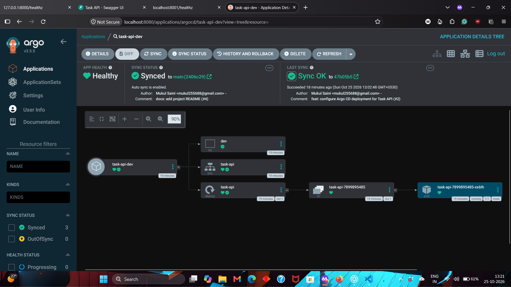

# AWS EKS GitOps Platform

A containerized FastAPI application deployed to Amazon EKS using Terraform, Kustomize, and Argo CD.

## Deployment flow

Terraform provisions the AWS network and EKS cluster. Docker builds and pushes the API image to ECR. Argo CD watches this repository and syncs the Kubernetes manifests from Git.

Image build and push are manual; Argo CD automates deployment.



## Stack

AWS EKS, ECR, Terraform, Docker, Kubernetes, Kustomize, Argo CD, Python, FastAPI

## Repository layout

```text
app/                  FastAPI application and Dockerfile
infra/terraform/      AWS infrastructure
gitops/apps/          Kubernetes base and dev overlay
gitops/argocd/        Argo CD Application
docs/images/          Argo CD deployment screenshot
```

## Run locally

```powershell
Set-Location .\app
python -m pip install -r requirements.txt
python -m uvicorn main:app --reload
```

Visit `http://localhost:8000/healthz` or `http://localhost:8000/docs`.

## Deploy

Set your public IP as `admin_cidr` in the ignored file `infra/terraform/terraform.tfvars`, then run:

```powershell
Set-Location .\infra\terraform
terraform init
terraform apply
Set-Location ..\..
kubectl apply -f .\gitops\argocd\task-api-dev.yaml
```

The application runs inside the cluster as Service `task-api` on port `80`.

## Cleanup

After publishing the project, destroy the infrastructure and delete the separate ECR repository:

```powershell
Set-Location .\infra\terraform
terraform destroy
Set-Location ..\..
aws ecr delete-repository --repository-name task-api --region ap-southeast-2 --force
```

Keep Terraform state until `terraform destroy` succeeds. AWS resources may incur charges while running.